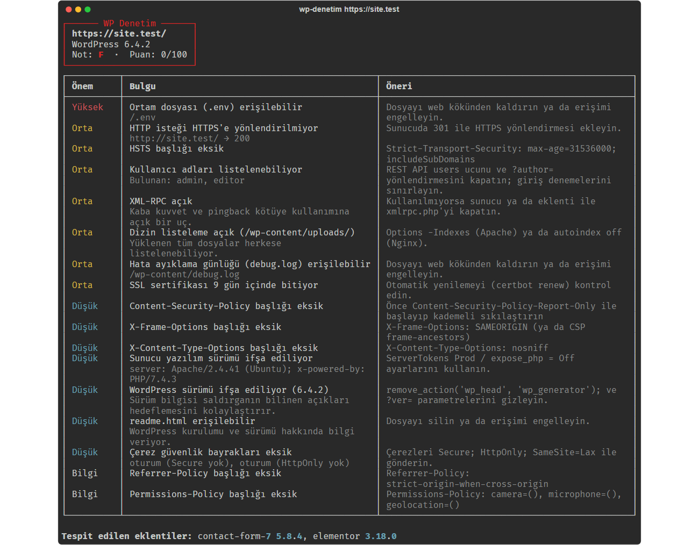
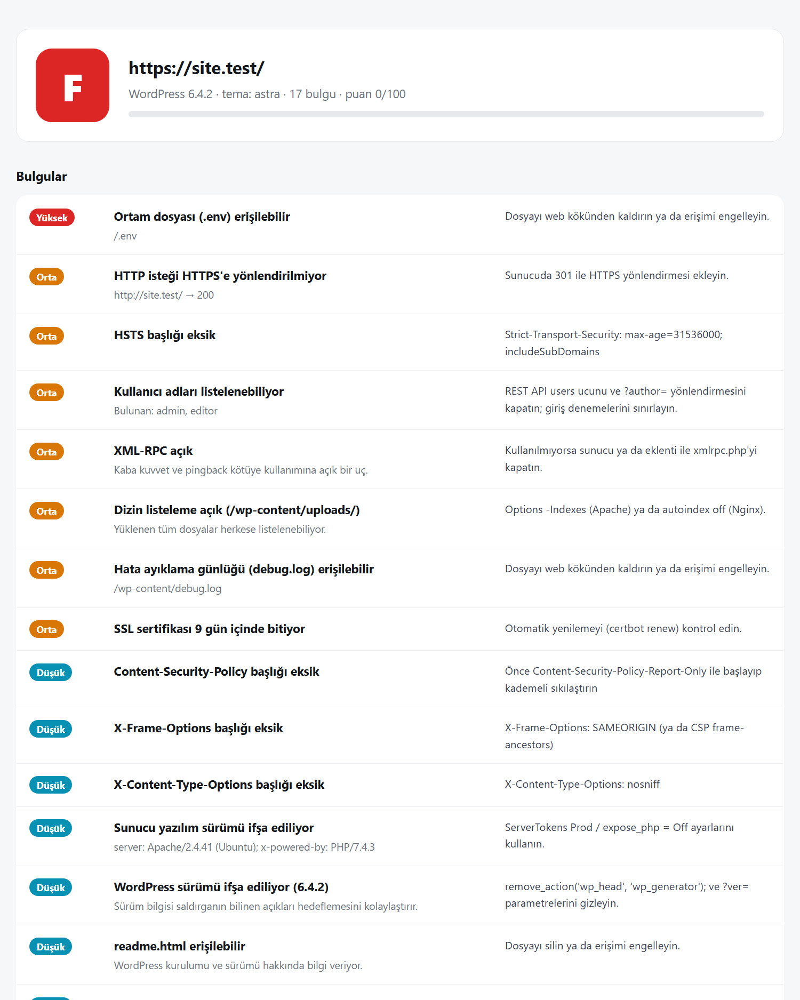

# WP Denetim — WordPress Güvenlik Denetimi

[](https://github.com/ilkertokat/wp-denetim/actions)


**WordPress sitelerindeki yaygın yapılandırma hatalarını saniyeler içinde bulan, pasif bir güvenlik denetim aracı.** Siteye A–F arası bir not verir; her bulgu için önem derecesini ve nasıl düzeltileceğini yazar. Sonucu terminale, müşteriye gönderilebilecek bir HTML rapora ya da CI hattında kullanılacak JSON'a yazar.

> *English summary below.*



## Neden?

Freelance olarak teslim ettiğim WordPress sitelerinde aynı hataları tekrar tekrar görüyordum: sürümü ele veren meta etiketleri, listelenebilen kullanıcı adları, açık bırakılmış XML-RPC, unutulmuş `debug.log` dosyaları. Teslimden önce her siteyi elle kontrol etmek yerine bu kontrolleri bir araca dönüştürdüm.

## Ne kontrol ediyor?

| Alan | Kontrol |
|---|---|
| 🔐 Taşıma | HTTPS kullanımı, HTTP → HTTPS yönlendirmesi, SSL sertifikasının bitiş tarihi |
| 🧱 Başlıklar | HSTS, Content-Security-Policy, X-Frame-Options, X-Content-Type-Options, Referrer-Policy, Permissions-Policy |
| 🕵️ Bilgi sızıntısı | WordPress sürümü (generator, `?ver=`, RSS), `readme.html`, `Server` / `X-Powered-By` sürümleri |
| 👤 Kullanıcılar | REST API (`/wp-json/wp/v2/users`) ve `?author=1` ile kullanıcı adı listeleme |
| 🚪 Saldırı yüzeyi | XML-RPC, `/wp-content/uploads/` dizin listeleme |
| 📄 Unutulan dosyalar | `.env`, `.git/HEAD`, `wp-config.php` yedekleri, `debug.log`, `phpinfo.php` (içerik imzasıyla doğrulanır, yanlış alarm vermez) |
| 🍪 Çerezler | `Secure` ve `HttpOnly` bayrakları |
| 🧩 Envanter | Kullanılan eklentiler ve sürümleri, aktif tema |

> ⚠️ **Yalnızca sahibi olduğunuz ya da test izniniz olan sitelerde kullanın.** Araç pasiftir: herkese açık sayfalara sadece `GET` isteği atar; form göndermez, parola denemez, hiçbir açığı istismar etmez.

## Kurulum ve kullanım

```bash
pip install -r requirements.txt
python -m wpdenetim https://ornek.com
python -m wpdenetim https://ornek.com --html rapor.html --json rapor.json
```

CI hattında, not belirli bir seviyenin altındaysa derlemeyi durdurmak için:

```bash
python -m wpdenetim https://staging.ornek.com --min-grade B   # C veya kötüyse çıkış kodu 1
```

### HTML rapor



## Puanlama

Her site 100 puanla başlar; bulgular önem derecesine göre puan düşürür (Yüksek −22, Orta −10, Düşük −4, Bilgi 0).

| Not | A | B | C | D | F |
|---|---|---|---|---|---|
| Puan | ≥ 90 | ≥ 75 | ≥ 60 | ≥ 40 | < 40 |

## Mimari

```
wpdenetim/
├── model.py     # Finding / Report veri sınıfları, önem dereceleri, puanlama
├── scanner.py   # Bağımsız kontrol fonksiyonları + scan() orkestrasyonu
├── render.py    # rich ile terminal çıktısı, bağımsız HTML rapor
└── cli.py       # typer komut satırı (--html, --json, --min-grade)
```

- Her kontrol `Context` alan küçük bir fonksiyon; yeni bir kontrol eklemek için `ALL_CHECKS` listesine bir fonksiyon eklemek yeterli.
- HTTP istemcisi ve SSL sorgusu dışarıdan verilebildiği için testler **ağa hiç çıkmadan** `httpx.MockTransport` üzerinde kurulmuş sahte sitelerle (açıklı ve sıkılaştırılmış) çalışıyor.
- HTML rapor tek dosya, harici bağımlılığı yok; tüm içerik kaçış karakterlerinden geçiriliyor.

## Testler

```bash
pytest -q      # 12 passed
python scripts/demo_report.py   # README görsellerini sahte siteden yeniden üretir
```

---

## English

**WP Denetim** ("WP Audit") is a passive security scanner for WordPress sites. It checks HTTPS and certificate expiry, security headers, version disclosure, username enumeration, XML-RPC, directory listing, leaked files (`.env`, `.git`, config backups, `debug.log`) and cookie flags, inventories plugins and the theme, then grades the site A–F with actionable fixes. Output goes to the terminal (rich), a standalone HTML report or JSON; `--min-grade` makes it usable as a CI gate. Built with Python, httpx, rich and typer; tests run fully offline against mock sites.

**Use it only on sites you own or are authorised to test.**

## Lisans

MIT © 2026 İlker Tokat
